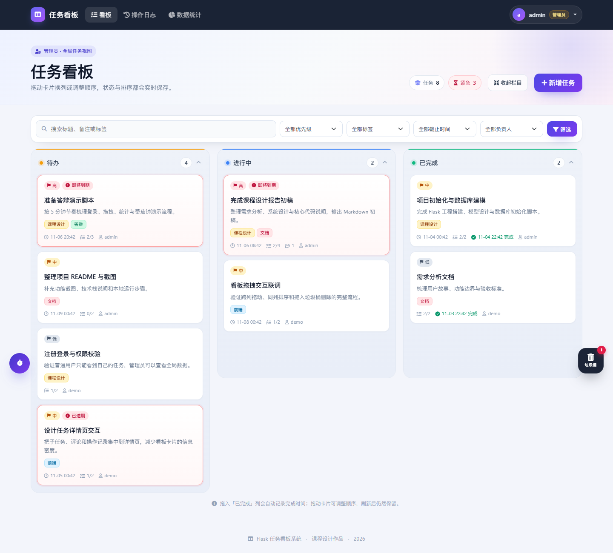
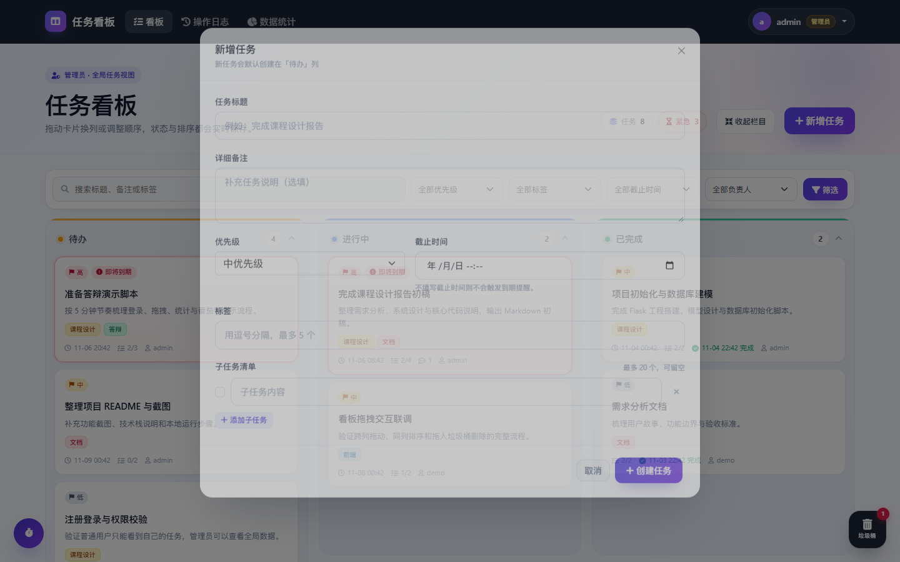
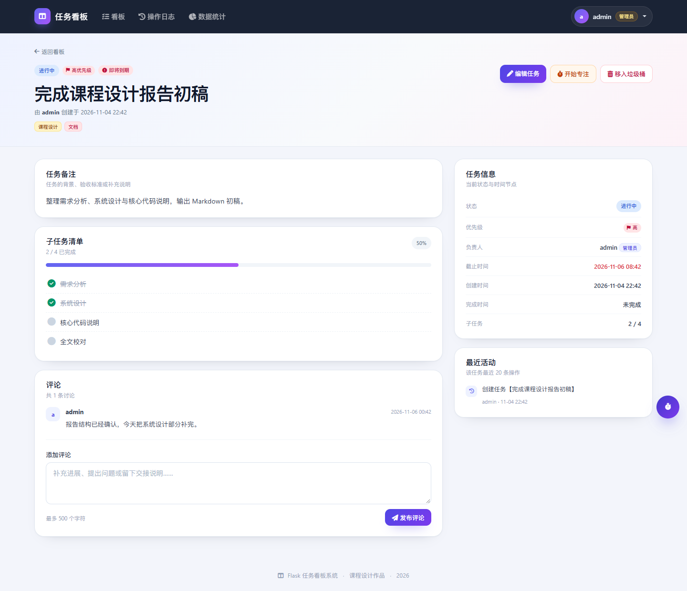
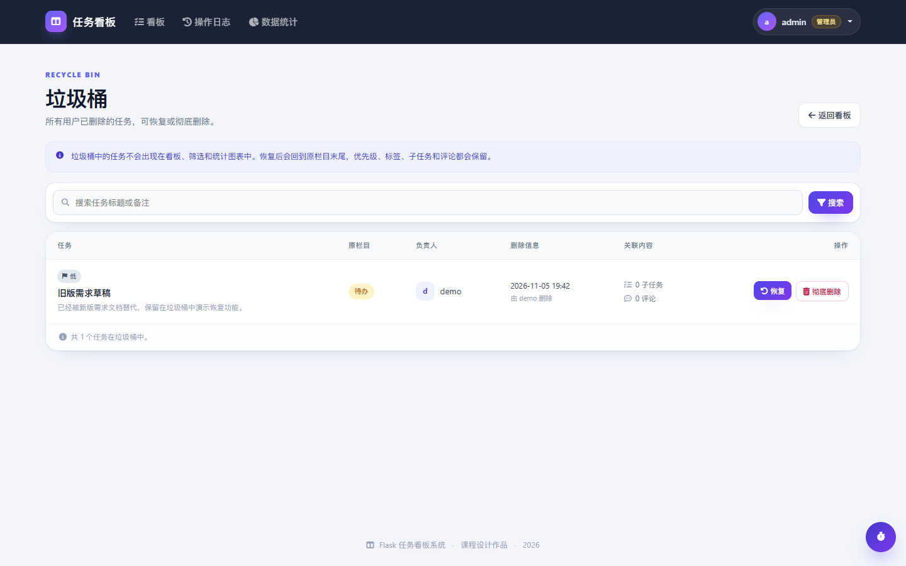
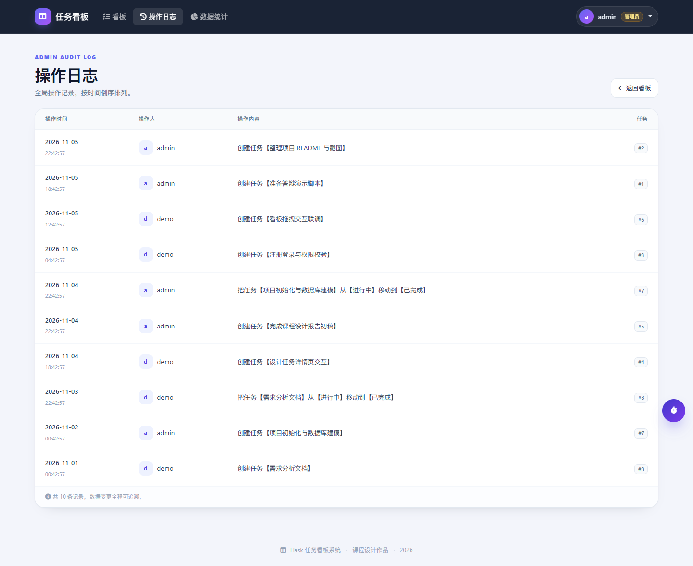
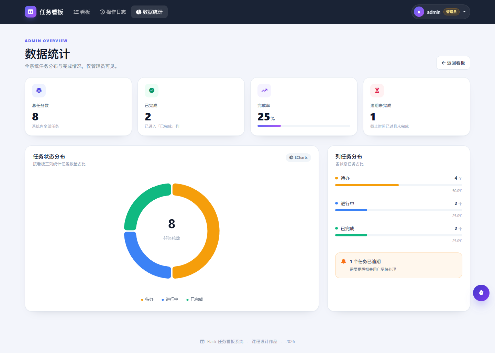
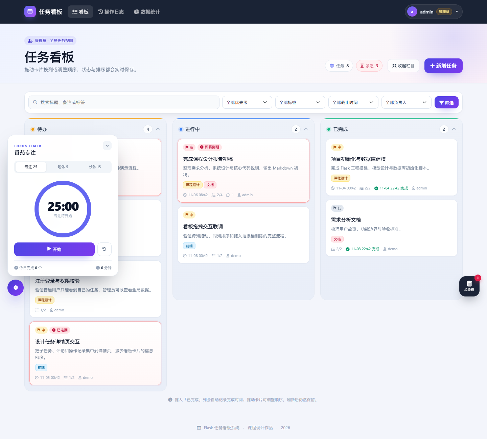
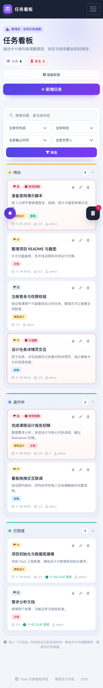
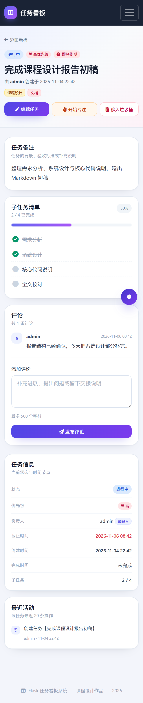

# TaskBoard · Flask 任务看板系统

一个适合课程设计与作品展示的轻量级任务看板：三列拖拽、优先级、标签、子任务、评论、垃圾桶、操作日志、番茄钟和统计图表。




## 项目简介

TaskBoard 是一个基于 Flask 的任务管理 Web 应用。用户注册登录后，可以在「待办 / 进行中 / 已完成」三列看板中管理自己的任务；管理员可以查看全局任务、操作日志和统计图表。

项目没有复杂的前端构建流程，也没有额外服务依赖，安装 Flask 依赖后即可运行，适合作为课程设计、面试作品或日常任务管理工具。

**演示账号**

| 角色 | 用户名 | 密码 | 可查看内容 |
| --- | --- | --- | --- |
| 管理员 | `admin` | `admin123` | 全部任务、操作日志、数据统计 |
| 普通用户 | `demo` | `demo123` | 仅自己的任务与操作记录 |

> 仓库已附带一套演示数据。如需重新生成，执行 `python seed_demo.py --reset`。

## 功能一览

### 1. 看板与拖拽

- 三列看板：待办、进行中、已完成
- 拖动卡片跨列：状态实时保存，无需刷新
- 拖动卡片同列排序：刷新后顺序仍然保留
- 拖入「已完成」列自动记录完成时间
- 卡片展示优先级、标签、截止时间、子任务进度和评论数
- 支持按关键词、优先级、标签、截止时间、负责人组合筛选



### 2. 任务详情

- 任务备注、优先级、截止时间、创建/完成时间
- 子任务清单与完成进度条
- 评论区
- 当前任务最近 20 条操作记录
- 从详情页直接进入编辑



### 3. 垃圾桶与操作日志

- 删除任务先进入垃圾桶，可恢复或彻底删除
- 看板拖拽删除后，支持「撤销」
- 恢复任务时保留优先级、标签、子任务和评论
- 操作日志记录创建、编辑、移动、评论、子任务、删除等行为

<p align="center">
  
</p>

<p align="center">
  
</p>

### 4. 数据统计

管理员可查看总任务数、已完成数、完成率、逾期任务数，以及任务状态分布饼图。



### 5. 番茄专注

- 专注 25 分钟、短休 5 分钟、长休 15 分钟
- 以任务卡片为入口，一键开始专注
- 计时状态保存在浏览器本地，刷新页面不会丢失
- 今日完成番茄数与专注分钟数统计

<p align="center">
  
</p>

### 6. 移动端适配

看板、筛选、详情页和登录页均适配移动端；底部悬浮按钮改为紧凑圆形，减少对内容的遮挡。

<p align="center">
  
  
</p>

## 技术栈

| 层次 | 技术 | 用途 |
| --- | --- | --- |
| 后端 | Python 3 + Flask 3 | 路由、登录状态、业务逻辑 |
| ORM | Flask-SQLAlchemy | 数据模型与查询 |
| 数据库 | SQLite | 零配置本地存储 |
| 登录 | Flask-Login | 会话保持与登录校验 |
| 模板 | Jinja2 | 页面渲染与组件复用 |
| 样式 | Bootstrap 5 + 自定义 CSS | 响应式布局与视觉样式 |
| 拖拽 | SortableJS | 卡片跨列拖动与排序 |
| 请求 | jQuery Ajax / Fetch | 无刷新移动、删除与撤销 |
| 图表 | ECharts | 任务状态分布 |
| 图标 | Font Awesome | 页面图标 |

## 快速开始

```bash
# 1. 安装依赖
python -m pip install -r requirements.txt

# 2. 启动项目（仓库自带演示数据）
python app.py

# 3. 浏览器访问
# http://127.0.0.1:5000
```

登录演示账号：

- 管理员：`admin` / `admin123`
- 普通用户：`demo` / `demo123`

如果想从空数据库开始：

```bash
# 删除演示数据库后重新启动，系统会自动建表并创建 admin 账号
# Windows 可以直接在资源管理器删除 instance/task_board.db
rm instance/task_board.db
python app.py
```

如果想重新生成演示数据：

```bash
python seed_demo.py --reset
```

## 项目结构

```text
Task-stystem/
├── app.py                        # Flask 主程序：查询、校验、路由、任务接口
├── models.py                     # User / Task / Tag / Subtask / Comment / Log
├── config.py                     # 数据库与密钥配置
├── seed_demo.py                  # 演示数据生成脚本
├── requirements.txt
├── instance/
│   └── task_board.db             # SQLite 演示数据库
├── templates/
│   ├── base.html                 # 公共布局
│   ├── board.html                # 看板页
│   ├── task_detail.html          # 任务详情页
│   ├── trash.html / log.html / report.html
│   ├── login.html / register.html
│   ├── components/               # 可复用页面组件
│   │   ├── navbar.html
│   │   ├── flash_messages.html
│   │   ├── filter_bar.html
│   │   ├── task_card.html
│   │   ├── task_modals.html
│   │   ├── forms.html
│   │   ├── page_heading.html
│   │   ├── status_badge.html
│   │   └── pomodoro.html
│   └── errors/                   # 404 / 500 页面
└── static/
    ├── css/                      # 全局样式、详情页样式、工作区工具样式
    ├── js/
    │   ├── main.js               # 全局 Toast 与提示自动关闭
    │   ├── board.js              # 拖拽、排序、筛选、栏目折叠
    │   ├── task-form.js          # 新增/编辑弹窗、子任务编辑器
    │   └── pomodoro.js           # 番茄钟
    ├── vendor/                   # Bootstrap / jQuery / Sortable / ECharts
    └── img/                      # favicon
```

## 核心实现说明

### 拖拽与排序

`static/js/board.js` 使用 SortableJS 监听卡片拖动，把任务 ID、目标栏目和当前顺序提交到 `/task/move`。后端更新 `Task.column_id` 与 `Task.position`，如果目标列是「已完成」，同时写入 `finish_time`。看板重新加载时按 `position` 排序，所以顺序会保留。

### 权限隔离

- 普通用户：任务查询自动追加 `owner_id = 当前用户`
- 管理员：可以查看所有用户任务、进行编辑和数据统计
- 所有任务操作都会经过 `get_task_or_none()` 做存在性、删除状态和归属校验
- 统计页只允许管理员访问

### 软删除与垃圾桶

删除任务不会直接删数据，而是设置 `is_deleted`、`deleted_at`、`deleted_by`。垃圾桶页面可以恢复或彻底删除任务；看板拖拽删除后支持 5 秒内撤销。

### 操作日志

创建、编辑、移动、评论、切换子任务、删除和恢复等操作都会写入 `TaskLog`。日志页对普通用户只展示本人记录，对管理员展示全局记录。

### 番茄钟

番茄钟完全在前端运行，状态保存在 `localStorage`，按用户名隔离。刷新页面后会根据结束时间恢复计时，不依赖后端接口。

## 页面预览

<p align="center">
  
</p>

## 已完成的浏览器回归

项目在本地使用 Chrome 自动化浏览器完成了 40 项检查，全部通过：

- 管理员/普通用户登录与退出
- 普通用户任务隔离、管理员统计权限
- 新建任务（标题、备注、优先级、截止时间、标签、子任务）
- 编辑任务与弹窗数据回填
- 跨列拖拽、同列排序、拖入垃圾桶与撤销
- 子任务勾选、评论发布
- 垃圾桶恢复与彻底删除
- 关键词/优先级/标签/截止时间/负责人筛选
- 桌面端 1440px 与移动端 390px 布局
- 404 页面与页面静态资源加载

## 说明

本项目定位为课程设计与个人演示，默认使用 SQLite 和 Flask 开发服务器，未包含生产部署配置。正式部署前建议补充 CSRF 防护、HTTPS、环境变量密钥管理和更细粒度的权限审计。

旧版课程设计报告已归档到 `docs/legacy/课程设计报告-旧版.md`，功能与运行方式以本 README 为准。
